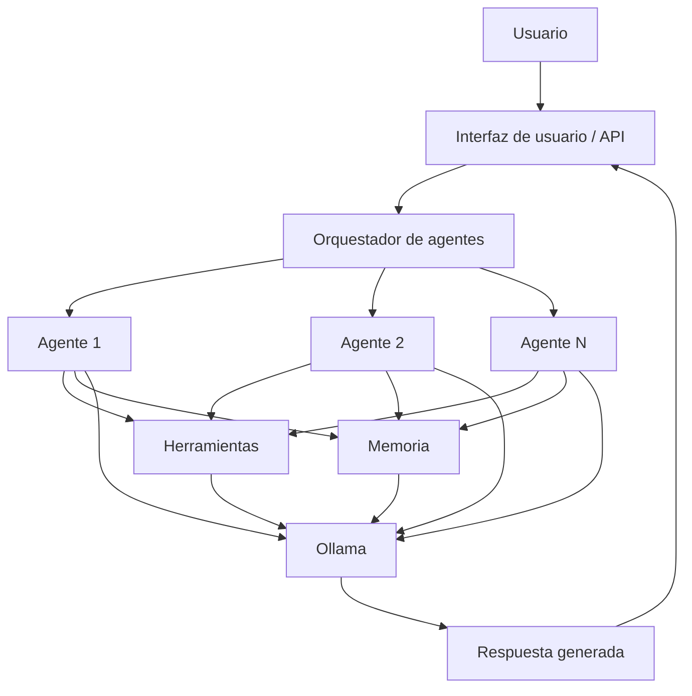
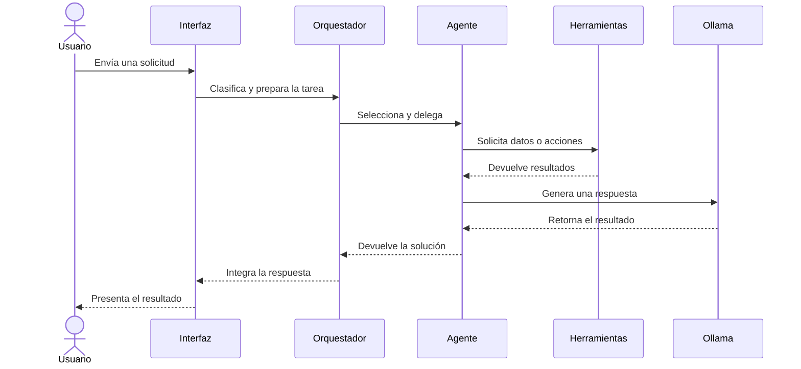

# 02 — Diagrama de Arquitectura

## Arquitectura general

## Flujo de interacción

## Responsabilidades por capa

| Capa | Responsabilidad |
|---|---|
| Interfaz | Recibir solicitudes y mostrar respuestas. |
| Orquestador | Clasificar tareas y coordinar agentes. |
| Agentes | Ejecutar tareas específicas con instrucciones y contexto. |
| Herramientas | Acceder a servicios, archivos o acciones externas. |
| Memoria | Conservar el contexto relevante de la interacción. |
| Ollama | Ejecutar localmente los modelos de lenguaje. |
